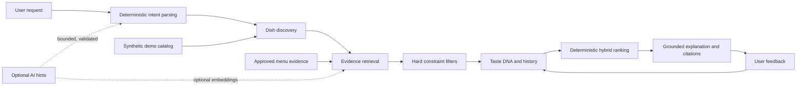

# TasteAI

**Local-first food intelligence for personalized, explainable dish recommendations.**

TasteAI turns a food request into a deterministic recommendation flow: understand intent, find eligible dishes, apply hard constraints, personalize with Taste DNA, rank transparently, explain from available evidence, and learn from feedback.

## What TasteAI does

TasteAI is a FastAPI application with a browser UI and versioned JSON API. It supports guest discovery and signed-in personalization, with a fictional demo menu available locally. Recommendations use deterministic parsing, constraint filtering, and ranking; optional AI integrations can provide bounded hints or retrieval support, but do not control the primary ranking or override hard constraints.

## Why it is technically interesting

- **Deterministic authority:** dietary exclusions and budget limits are applied as hard filters before ranking.
- **Personalization with provenance:** Taste DNA distinguishes explicit preferences from bounded, feedback-learned values and history.
- **Evidence-aware recommendations:** approved menu evidence is kept separate from synthetic demo data and restaurant-place candidates.
- **Grounded explanations:** result explanations use available dish attributes or approved evidence, with unknown, stale, and conflicting facts kept distinct.
- **Controlled optional AI:** LLM, external embeddings, OCR, and live place providers have separate opt-ins; AI output is validated and remains subordinate to deterministic safeguards.

## Current demo

The public demo catalog contains **1,000 synthetic Indian dishes**. It is fictional demo content, not verified restaurant menus, prices, ingredients, or availability. The demo is intended to exercise the product flow and regression tests; it does not represent live restaurant coverage or measured recommendation accuracy.

The UI and API support searches such as “spicy chicken under ₹350,” as well as My Usual, Something Different, and Surprise Me modes. Results are drawn from the fictional catalog unless approved menu evidence is available for the request. A demo dish must not be interpreted as a real restaurant offering.

## Architecture and data flow



The synthetic catalog and approved restaurant-menu evidence are separate domains. Restaurant discovery can return transient place candidates, but a place listing alone does not establish a menu, price, or dish availability.

## Key capabilities

- Deterministic intent parsing, search modes, hard constraints, and explainable ranking.
- Taste DNA, food memories, history, and bounded feedback learning.
- Reviewer-gated menu-source and restaurant-identity workflows, with provenance, freshness, approval, conflict, and stale-state handling.
- Offline menu-photo upload/review/commit foundations; the default extractor is disabled and no real menu ingestion is implied.
- Approved-evidence RAG with deterministic lexical retrieval, optional separately gated embeddings, typed claim validation, and cited deterministic fallback wording.
- Provider-neutral restaurant discovery interfaces for optional Google Places and OpenStreetMap adapters; live calls are explicit, bounded, and disabled by the tracked example configuration.
- Bounded internal agent tools with typed contracts, read-only authorization, call/time limits, and sanitized errors.

## Quick start

From the repository root in PowerShell:

```powershell
python -m venv tasteai\.venv
.\tasteai\.venv\Scripts\Activate.ps1
python -m pip install -r tasteai\requirements-dev.txt
$env:TASTEAI_SECRET_KEY = (python -c "import secrets; print(secrets.token_urlsafe(48))")
$env:TASTEAI_AUTO_CREATE_SCHEMA = "true"
python -m uvicorn tasteai.app:app --reload --port 8000
```

Open `http://127.0.0.1:8000`; API documentation is at `/docs`. The command explicitly enables local automatic Alembic migration and catalog seeding for first-run convenience. **Automatic schema migration is off by default** (`TASTEAI_AUTO_CREATE_SCHEMA=false` when unset); for production, keep it off and apply reviewed migrations explicitly. SQLite is the default local database. See [DEVELOPMENT.md](DEVELOPMENT.md) for configuration and [DEPLOYMENT.md](DEPLOYMENT.md) for the documented container workflow.

## Testing and evaluation

Run the offline test suite and deterministic evaluator from the repository root:

```powershell
python -m pytest -q
python -m tasteai.evaluation.run --strict
```

Latest verified results: **196 tests passed, 1 skipped, 45 subtests**; the strict evaluator passed **110/110 cases**. The evaluator's intent expectations were 165/165, hard constraints 179/179, requested top-match attributes 8/8, grounded explanation claims 494/494, RAG claim classifications 5/5, RAG retrieval checks 5/5, and multi-restaurant checks 5/5. These are deterministic synthetic regression checks—not real-world recommendation accuracy, satisfaction, or live-provider performance. See [EVALUATION.md](EVALUATION.md) for methodology and caveats.

## Data, evidence, and safety

No menu source is approved by default. Synthetic demo items are never treated as approved restaurant evidence. Provider candidates do not prove menu contents or availability; unknown, stale, and conflicting evidence remains explicit, and hard constraints fail closed when supporting facts are unknown. Menu-photo proposals require reviewer action before evidence promotion.

External OpenAI, Google Places, and OpenStreetMap integrations are optional and must be explicitly configured. Do not put credentials in tracked files; use a private environment source. Review the source-specific rights, attribution, retention, and operational limits before enabling a provider. Read [SECURITY.md](SECURITY.md) and [DATA_SOURCES.md](DATA_SOURCES.md) before configuring external sources.

## Limitations

The synthetic catalog is not real restaurant coverage, and the project has no comprehensive licensed live-menu dataset or live availability feed. The offline evaluator does not measure real-world quality. Optional LLM and embedding paths are not the sole source of recommendation truth; the default menu-photo extractor is disabled, and OCR, live discovery, and external AI behavior are not implied by offline tests.

## Project documentation

- [TasteAI application guide](tasteai/README.md)
- [API reference](API.md)
- [Data sources and rights](DATA_SOURCES.md)
- [Evaluation methodology and results](EVALUATION.md)
- [Architecture](TASTEAI_ARCHITECTURE.md)
- [Security](SECURITY.md)
- [Development setup](DEVELOPMENT.md)
- [Deployment](DEPLOYMENT.md)
